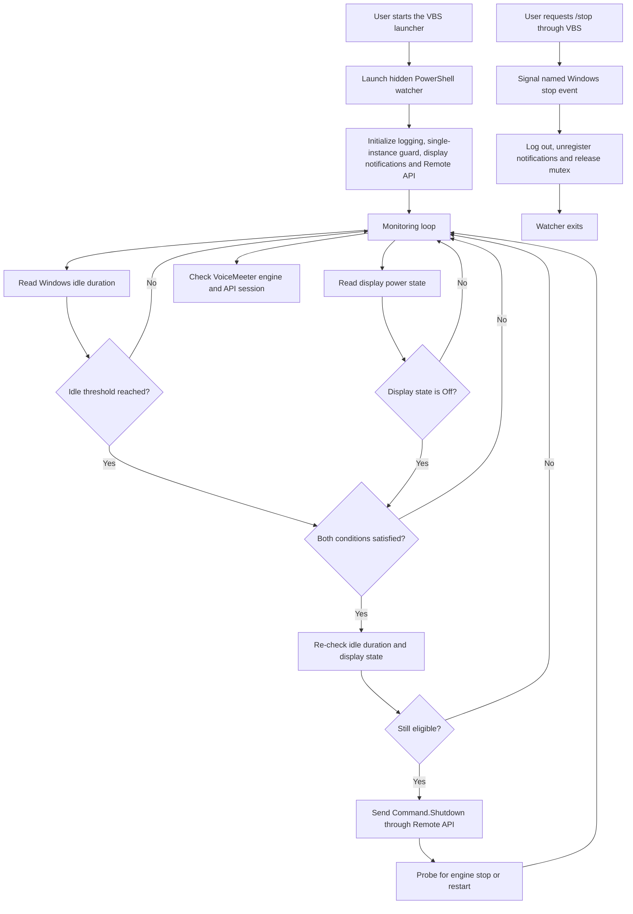
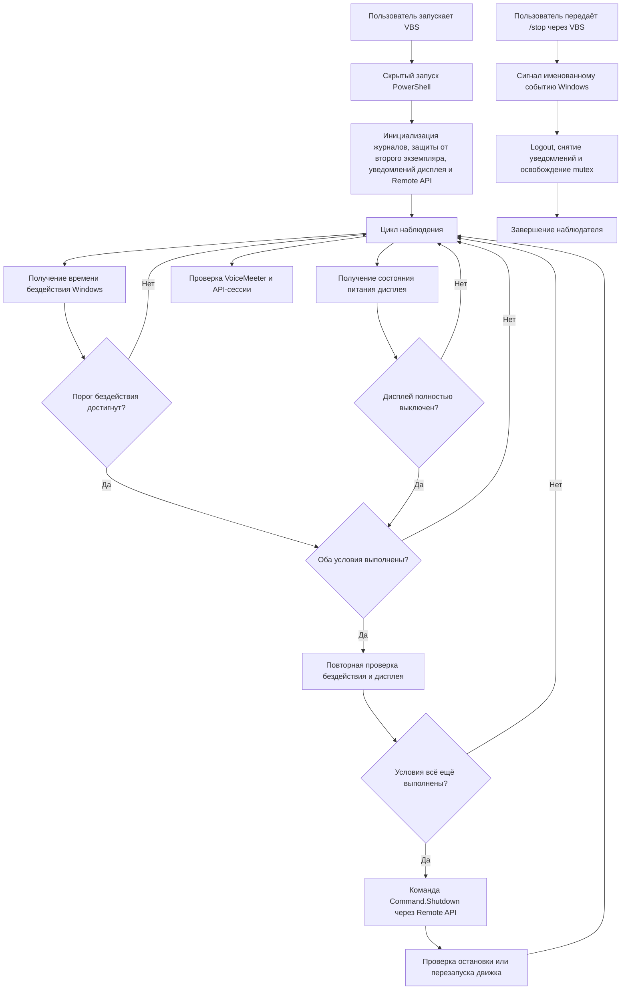

# Architecture / Архитектура

[English](#english) | [Русский](#русский)

## English

This document gives a high-level view of the watcher's control flow. It complements the source code; the PowerShell and VBScript files remain the definitive implementation.

### Main control flow

### Safety conditions

Automatic shutdown is permitted only when **both** conditions are true at the final check:

1. The configured Windows idle threshold has been reached.
2. The display power state is **Off (0)**.

Display **On (1)**, **Dimmed (2)**, or an unknown display state blocks automatic shutdown. The conditions are checked again immediately before the shutdown command is sent.

If VoiceMeeter is not running, the watcher continues monitoring. It can detect a later engine start and apply the same conditions while the computer remains idle and the display remains Off.

### Start and stop

- The VBS launcher starts PowerShell hidden and waits for an explicit startup status.
- The `/stop` argument signals the running watcher through a named Windows event.
- A graceful stop logs out of the Remote API, unregisters display notifications, closes stop-event resources, releases the single-instance mutex and exits.
- Stopping the watcher does **not** itself shut down VoiceMeeter.

### Scope

This is a simplified architecture diagram, not a complete representation of every retry, timeout, API recovery path or logging branch. Consult the current source files for exact behavior.

## Русский

Этот документ показывает общую логику работы наблюдателя. Он дополняет исходный код; фактическая реализация определяется файлами PowerShell и VBScript.

### Основной поток работы

### Условия безопасности

Автоматическое отключение разрешено только при одновременном выполнении **двух условий** во время финальной проверки:

1. Достигнут заданный порог бездействия Windows.
2. Состояние питания дисплея — **Off (0)**.

Состояния дисплея **On (1)**, **Dimmed (2)** или неизвестное состояние блокируют автоматическое отключение. Оба условия повторно проверяются непосредственно перед отправкой команды выключения.

Если VoiceMeeter не запущен, наблюдатель продолжает мониторинг. Он может обнаружить последующий запуск движка и применить те же условия, пока компьютер остаётся бездействующим, а дисплей выключен.

### Запуск и остановка

- VBS-запускатель скрыто запускает PowerShell и ожидает явного статуса запуска.
- Аргумент `/stop` передаёт работающему наблюдателю сигнал через именованное событие Windows.
- При штатной остановке выполняется Logout из Remote API, снимаются уведомления дисплея, закрываются ресурсы события, освобождается mutex единственного экземпляра, после чего процесс завершается.
- Остановка наблюдателя **сама по себе не выключает VoiceMeeter**.

### Границы схемы

Это упрощённая схема архитектуры, а не полное отображение всех повторных попыток, тайм-аутов, веток восстановления API и журналирования. Точное поведение следует сверять с актуальными исходниками.
