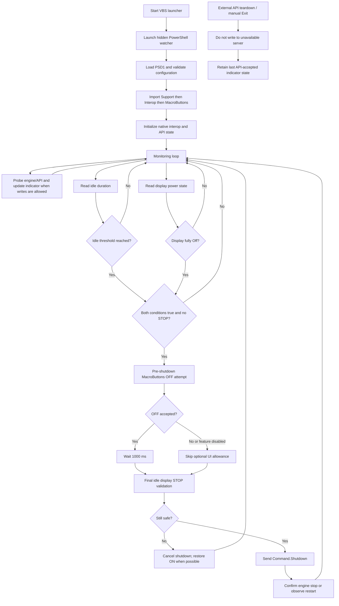
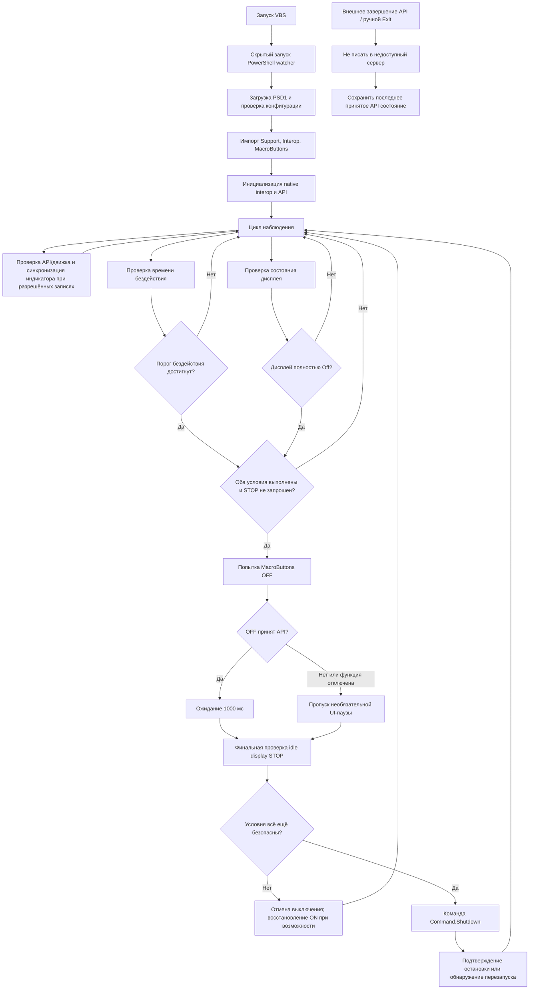

# Architecture / Архитектура

[English](#english) | [Русский](#русский)

## English

This document describes the modular source structure integrated into public `main` and maintained as v1.0.6. The v1.0.6 source passed static CI and maintainer-reported target-PC runtime validation on 2026-11-24. The immutable `v1.0.6` tag and stable GitHub Release were published on 2026-11-24; the release notes remain available from the [GitHub Release](https://github.com/AnAllegory/VoiceMeeter-IdleWatcher/releases/tag/v1.0.6). The Portable ZIP originally published from `gh-pages` was withdrawn from the public download path on 2026-11-25. Ready-to-run ZIP distribution is temporarily paused while the reported Google Search Console and Microsoft Defender detections are investigated. GitHub-generated source archives may remain accessible, but they are not project-built Portable packages or an approved runtime distribution during this pause. It follows the earlier monolithic implementation and uses a CI workflow aligned with the modular source layout. See REPOSITORY_LINEAGE.md for the project history. The current source files define the implementation if any wording here becomes stale.

### Modules and ownership

The main PS1 is the orchestrator. It loads and validates PSD1 configuration, imports the modules in the required order and owns the monitoring/shutdown state machine.

| Component | Responsibility |
|---|---|
| VoiceMeeter-IdleWatcher.ps1 | Orchestration, engine state, idle/display gates, shutdown/retry logic, lifecycle coordination |
| VoiceMeeter-IdleWatcher.psd1 | Validated configuration values |
| VoiceMeeter-IdleWatcher.Support.psm1 | Logging, startup status, stop and immediate-refresh signaling |
| VoiceMeeter-IdleWatcher.Interop.psm1 | Remote DLL discovery, C# source substitution/compile, API Login recovery |
| VoiceMeeter-IdleWatcher.MacroButtons.psm1 | Single STATEONLY writer, last accepted state and last write result |
| VMRIdleWatcherNative.cs | Windows display/idle/events and VoiceMeeter Remote API native declarations |
| VoiceMeeter-IdleWatcher.vbs | Hidden PowerShell launcher, startup-status handling and graceful /stop |

Import order is **Support -> Interop -> MacroButtons**. Keep the PS1, PSD1, VBS, three PowerShell modules and C# source together.

### Main lifecycle

### Shutdown safety gate

An automatic shutdown command is permitted only when all required safety conditions remain true at the final validation immediately before dispatch:

- The Windows idle threshold is reached.
- The display is fully Off (0).
- No graceful /stop request is pending.

On (1), Dimmed (2), unknown or unavailable display state blocks shutdown. The final validation occurs after the 1000ms refresh allowance when the optional STATEONLY OFF write succeeded. If a condition changes during the wait, shutdown is cancelled and ON is restored when the Remote API still permits it.

Stopping the watcher does not issue Command.Shutdown.

### Remote API and MacroButtons state

The Remote API is the authority for writes. A successful Login does not alone prove that the VoiceMeeter engine is running; the engine is probed separately.

MacroButtons is optional and non-fatal. Its module owns the only STATEONLY write path:

- STATEONLY is fixed to 0x00000002 inside VoiceMeeter-IdleWatcher.MacroButtons.psm1.
- The default logical button index is 1; -1 disables the feature.
- ON is asserted while the engine is confirmed available.
- OFF is attempted before an IdleWatcher-issued automatic shutdown, while the API is still available.
- Periodic synchronization and explicit refresh require both known API state and a confirmed running engine.
- When IsParametersDirty = -2 confirms that the server is unavailable, no periodic/manual OFF write is attempted. The last API-accepted indicator state is retained.
- When engine stop is confirmed, the temporary pending-shutdown marker is cleared. LastAccepted remains separate and continues to report the last API-accepted write.
- On graceful watcher stop, ON is asserted only if the API confirms the engine is available. If not, the last accepted state is retained.

The watcher does not use GetStatus for button-state readback and does not call MacroButton_IsDirty. A SetStatus return code of zero means that the Remote API accepted the command; it does not prove that the MacroButtons window has rendered the new state.

The status fields have distinct meanings:

| Field | Meaning |
|---|---|
| Desired | State the watcher currently wants the indicator to show |
| LastAccepted | Last state successfully accepted by Remote API |
| WriterStatus | Result/status of the most recent MacroButtons write attempt; not live API health |
| LastAcceptedAt | Time of the last successful API acceptance |

### Pre-shutdown display-refresh allowance

The 1000ms wait is a timing allowance intended to give the MacroButtons application's own state-change polling loop time to process the new state before the VoiceMeeter engine closes. The watcher does not poll or read back the displayed button state. The allowance is not a guarantee of visual refresh.

If the feature is disabled or OFF is not accepted, the optional wait is skipped. MacroButtons failure does not become a fatal shutdown prerequisite. Regardless of the optional indicator result, the final idle/display/STOP safety validation remains mandatory before an automatic shutdown command.

### API result handling

- IsParametersDirty() >= 0: Remote API is responding; the source separately determines whether the engine is confirmed running.
- -2: no Remote API server. This is the known unavailable transition; writes are skipped and the last accepted indicator state is retained.
- -1 or another undocumented negative result: API/client state is not safely resolved. The watcher must not treat an unknown result as proof that the engine stopped or send an OFF transition on that assumption.
- Login success and engine availability are distinct facts.

### DLL selection and C# marker contract

The DLL is chosen by the **PowerShell watcher process architecture**, not by guessing the VoiceMeeter process bitness:

- 64-bit PowerShell: VoicemeeterRemote64.dll
- 32-bit PowerShell: VoicemeeterRemote.dll

The C# source contains exactly one __VOICEMEETER_DLL_PATH__ marker inside the verbatim string literal. Interop reads the file as UTF-8, doubles embedded quotes in the selected path and replaces the marker before compilation. Preserve this contract.

### Graceful stop and cleanup

A normal /stop request signals the running watcher. The watcher leaves its main loop and performs cleanup: it handles the indicator according to confirmed API availability, logs out, unregisters display notifications, closes synchronization events and releases the single-instance mutex. It does not shut down VoiceMeeter as a side effect of stopping itself.

### Known lifecycle limitation

A manual VoiceMeeter Exit can remove the Remote API server before the watcher can deliver a STATEONLY OFF command. After -2, an OFF write cannot be made through that server. This is an accepted API lifecycle limitation. The project does not add process polling, WMI, Process.Exited handlers, launcher ownership or a second writer.

### Runtime evidence boundary

The maintainer's 2026-11-22 v1.0.5 test confirmed the automatic sequence in the log: OFF accepted at 16:14:13.513, 1000ms allowance started at 16:14:13.519, final validation passed at 16:14:14.537, Shutdown returned code 0 at 16:14:14.557 and engine stop was confirmed at 16:14:15.617. After waking the PC, the maintainer observed button 1 OFF and VoiceMeeter absent.

This confirms the post-wake end state and the shutdown sequence. It does **not** establish the exact visual instant at which the button extinguished relative to engine shutdown, because the display was Off during that interval. CI cannot resolve this UI timing question.

## Русский

Этот документ описывает модульную структуру исходников, интегрированную в публичную ветку `main` и сопровождаемую как v1.0.6. Исходники v1.0.6 прошли статические проверки CI и runtime-проверку сопровождающим на целевом ПК 2026-11-24. Создание Git-тега и публикация GitHub Release завершаются отдельным административным шагом. Структура продолжает первоначальную монолитную реализацию, а workflow соответствует модульным исходникам. История проекта описана в REPOSITORY_LINEAGE.md. Если формулировка в документации расходится с исходниками, приоритет имеют актуальные исходники.

### Модули и ответственность

Главный PS1 является оркестратором. Он загружает и проверяет конфигурацию PSD1, импортирует модули в заданном порядке и управляет автоматом состояний наблюдения и выключения.

| Компонент | Ответственность |
|---|---|
| VoiceMeeter-IdleWatcher.ps1 | Оркестрация, состояние движка, проверки idle/display, выключение, повторы и жизненный цикл |
| VoiceMeeter-IdleWatcher.psd1 | Проверяемые параметры конфигурации |
| VoiceMeeter-IdleWatcher.Support.psm1 | Журналирование, статус запуска, сигналы остановки и немедленного обновления |
| VoiceMeeter-IdleWatcher.Interop.psm1 | Поиск Remote DLL, подстановка C#-источника, компиляция и восстановление Login |
| VoiceMeeter-IdleWatcher.MacroButtons.psm1 | Единственный writer STATEONLY, последнее принятое состояние и результат последней записи |
| VMRIdleWatcherNative.cs | Нативные объявления Windows display/idle/events и VoiceMeeter Remote API |
| VoiceMeeter-IdleWatcher.vbs | Скрытый запуск PowerShell, обработка статуса запуска и штатный /stop |

Порядок импорта: **Support -> Interop -> MacroButtons**. PS1, PSD1, VBS, три PowerShell-модуля и C#-файл должны находиться вместе.

### Основной жизненный цикл

### Защитная проверка перед выключением

Автоматическое выключение разрешено только тогда, когда непосредственно перед отправкой команды остаются истинными все условия:

- Достигнут порог бездействия Windows.
- Дисплей полностью выключен (0).
- Не поступил запрос штатной остановки /stop.

Состояния On (1), Dimmed (2), неизвестное или недоступное блокируют выключение. Если необязательная команда STATEONLY OFF принята, после паузы 1000 мс все три условия проверяются повторно. Если во время ожидания хотя бы одно условие изменилось, выключение отменяется, а ON восстанавливается, пока Remote API ещё доступен.

Остановка watcher не отправляет Command.Shutdown.

### Remote API и состояние MacroButtons

Remote API является единственным каналом записи. Успешный Login сам по себе ещё не означает, что движок VoiceMeeter запущен; состояние движка проверяется отдельно.

MacroButtons остаётся необязательной функцией, ошибки которой не должны останавливать watcher. Единственный путь записи находится в MacroButtons-модуле:

- STATEONLY зафиксирован в VoiceMeeter-IdleWatcher.MacroButtons.psm1 как 0x00000002.
- Логический ID кнопки по умолчанию — 1; значение -1 отключает функцию.
- ON устанавливается, пока движок подтверждённо доступен.
- Перед автоматическим выключением по команде IdleWatcher отправляется OFF, пока API ещё доступен.
- Периодическая синхронизация и принудительный Refresh требуют известного состояния API и подтверждённо работающего движка.
- Когда IsParametersDirty = -2 подтверждает отсутствие сервера, периодические и ручные OFF-записи прекращаются. Сохраняется последнее состояние, принятое API.
- После подтверждения остановки движка временный маркер ожидающего выключения очищается. Поле LastAccepted независимо сохраняет последнее состояние, принятое API.
- При штатной остановке watcher команда ON отправляется только при подтверждённой доступности движка. Иначе последнее принятое состояние сохраняется.

Watcher не использует GetStatus для обратного считывания состояния кнопки и не вызывает MacroButton_IsDirty. Возврат SetStatus с кодом 0 означает, что Remote API принял команду; он не подтверждает, что окно MacroButtons уже отобразило новое состояние.

Поля статуса имеют разные значения:

| Поле | Значение |
|---|---|
| Desired | Состояние, которое watcher хочет установить |
| LastAccepted | Последнее состояние, успешно принятое Remote API |
| WriterStatus | Результат/статус последней записи MacroButtons, а не текущая доступность API |
| LastAcceptedAt | Время последнего успешного принятия команды API |

### Пауза для обновления отображения перед выключением

Ожидание 1000 мс предназначено для того, чтобы приложение MacroButtons успело обработать изменение состояния собственным циклом опроса до закрытия движка VoiceMeeter. Watcher не считывает видимое состояние кнопки. Эта пауза не гарантирует визуальное обновление.

Если функция отключена или OFF не принят, необязательная пауза пропускается. Ошибка MacroButtons не становится обязательным условием для выключения. При любом исходе необязательной записи финальная проверка idle/display/STOP перед автоматическим выключением обязательна.

### Обработка результатов API

- IsParametersDirty() >= 0: Remote API отвечает; состояние запущенного движка дополнительно определяется исходным кодом.
- -2: сервер Remote API отсутствует. Записи пропускаются, последнее принятое состояние индикатора сохраняется.
- -1 или другое недокументированное отрицательное значение: состояние API/клиента не разрешено безопасным образом. Не следует считать неизвестный результат доказательством остановки движка или на этом основании отправлять OFF.
- Успешный Login и доступность движка — разные факты.

### Выбор DLL и контракт маркера C#

DLL выбирается по **разрядности процесса PowerShell watcher**, а не по предполагаемой разрядности процесса VoiceMeeter:

- 64-разрядный PowerShell: VoicemeeterRemote64.dll
- 32-разрядный PowerShell: VoicemeeterRemote.dll

В C#-файле ровно один маркер __VOICEMEETER_DLL_PATH__ внутри verbatim-строки. Interop читает файл как UTF-8, удваивает кавычки в выбранном пути и заменяет маркер до компиляции. Этот контракт необходимо сохранять.

### Штатная остановка и очистка

Запрос /stop передаёт сигнал работающему watcher. Тот выходит из основного цикла и выполняет очистку: обновляет индикатор в соответствии с подтверждённой доступностью API, выполняет Logout, снимает уведомления дисплея, закрывает события синхронизации и освобождает mutex единственного экземпляра. Остановка watcher сама по себе не выключает VoiceMeeter.

### Известное ограничение жизненного цикла

При ручном Exit VoiceMeeter сервер Remote API может исчезнуть раньше, чем watcher сможет отправить STATEONLY OFF. После -2 отправить OFF через этот сервер невозможно. Это принятое ограничение API. В проект не добавляются опрос процессов, WMI, Process.Exited, управление жизненным циклом через launcher или второй writer.

### Границы доказательств runtime-теста

В тесте v1.0.5 от 2026-11-22 сопровождающий подтвердил журналом следующую последовательность автоматического выключения: OFF принят в 16:14:13.513, пауза 1000 мс началась в 16:14:13.519, финальная проверка пройдена в 16:14:14.537, Shutdown вернул код 0 в 16:14:14.557, остановка движка подтверждена в 16:14:15.617. После пробуждения ПК сопровождающий увидел, что кнопка 1 погашена, а VoiceMeeter не запущен.

Это подтверждает конечное состояние после пробуждения и саму последовательность выключения. Но точный визуальный момент погасания кнопки относительно остановки движка **не установлен**, поскольку дисплей в этот промежуток был выключен. CI не может разрешить этот вопрос интерфейса.
