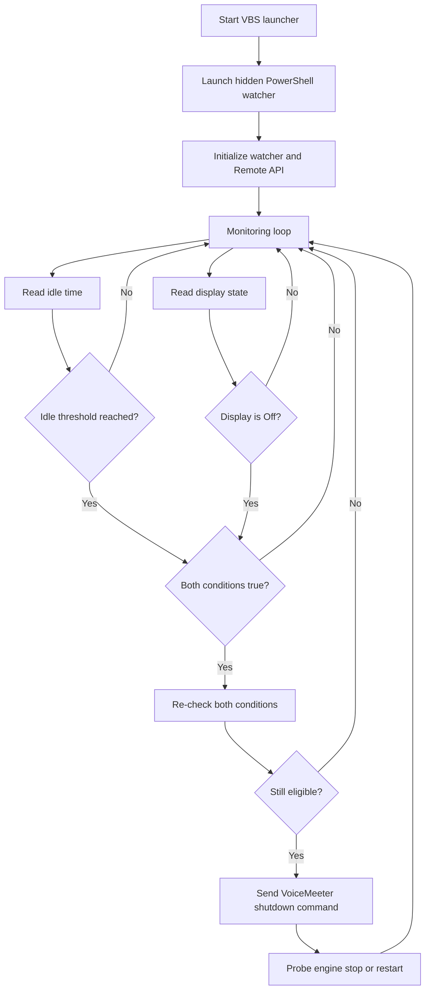

# VoiceMeeter IdleWatcher

[English](README.md) | [Русский](README.ru.md)

A Windows PowerShell automation tool for VoiceMeeter. It monitors Windows idle time and the display power state, and requests VoiceMeeter shutdown only when the configured idle threshold has elapsed and the display is fully off.

**Maintainer's handover notes:** see [PROJECT_CONTEXT.md](PROJECT_CONTEXT.md). This is the working reference for project history, verified behavior, known limitations, and how to resume work in a new ChatGPT conversation.

## Features

- Monitors Windows user idle time.
- Monitors the display power state through Windows power notifications.
- Allows automatic VoiceMeeter shutdown only when both conditions are true:
  - The idle threshold has been reached.
  - The display state is **Off** (0).
- Blocks automatic shutdown when the display is **On** (1), **Dimmed** (2), or unknown.
- Uses the VoiceMeeter Remote API.
- Discovers the matching Remote API DLL from the VoiceMeeter installation and Windows registry.
- Prevents multiple watcher instances with a named mutex.
- Supports graceful stop through a named Windows event.
- Writes primary, fallback, and emergency logs.

## How it works

The watcher periodically checks Windows idle duration and the current display state.

The default idle threshold is **8 minutes**. A shutdown request is sent only when the display is fully off and the idle threshold has elapsed. The script checks both conditions again immediately before sending the VoiceMeeter shutdown command.

If VoiceMeeter is not running, the watcher continues monitoring. If VoiceMeeter restarts while the computer remains idle and the display remains off, the watcher can detect the restart and send the shutdown request again.

An unknown display state is treated as a safe condition: automatic shutdown remains blocked.

## Architecture

The diagram below summarizes the main control flow. For the bilingual explanation and the stop/cleanup path, see [ARCHITECTURE.md](ARCHITECTURE.md).

## Current configuration

| Setting | Default | Description |
|---|---:|---|
| IdleMinutes | 8 | Idle threshold in minutes. Allowed range: 1–60. |
| CheckIntervalSec | 10 seconds | Normal main-loop wait interval. |
| RetryIntervalSec | 30 seconds | Retry interval after API errors. |
| DebugMode | Off | Enables verbose DEBUG log entries when the -DebugMode switch is supplied. |

The script also uses shorter internal intervals for API recovery and for checking whether VoiceMeeter has stopped or restarted after a shutdown request.

## Project files

| File | Purpose |
|---|---|
| VoiceMeeter-IdleWatcher.ps1 | Main PowerShell watcher and VoiceMeeter Remote API integration. |
| VoiceMeeter-IdleWatcher.vbs | Hidden launcher and graceful-stop entry point. |
| README.md | English documentation. |
| README.ru.md | Russian documentation. |
| PROJECT_CONTEXT.md | Maintainer's project handover and context reference. |
| ARCHITECTURE.md | Bilingual architecture overview and Mermaid diagrams. |
| CHANGELOG.md | Repository change history and development baseline. |
| .gitignore | Excludes local logs, temporary files, backups, and KeePass databases from Git. |
| .github/workflows/powershell-check.yml | Runs automated Windows PowerShell 5.1 parser and PSScriptAnalyzer checks. |

Keep the PS1 and VBS files in the same directory. The VBS launcher locates the PS1 file beside itself and expects the matching base filename.

## Requirements

- Windows.
- Windows PowerShell 5.1.
- VoiceMeeter installed.
- The VoiceMeeter Remote API DLL matching the PowerShell process architecture.
- Windows Script Host enabled for the VBS launcher.

The script searches VoiceMeeter installation information in the Windows registry and common Program Files locations for the appropriate DLL: VoicemeeterRemote64.dll for a 64-bit PowerShell process or VoicemeeterRemote.dll for a 32-bit process.

## Start and stop

### Start

Double-click VoiceMeeter-IdleWatcher.vbs, or run:

~~~text
wscript.exe VoiceMeeter-IdleWatcher.vbs
~~~

The VBS launcher starts Windows PowerShell hidden and waits for an explicit startup status. An early startup failure is reported instead of being silently treated as a successful launch.

### Stop

Run the VBS launcher with /stop:

~~~text
wscript.exe VoiceMeeter-IdleWatcher.vbs /stop
~~~

The stop request is sent through a named Windows event. The watcher then logs out from the VoiceMeeter Remote API, closes its notification resources, releases its single-instance mutex, and exits. The launcher waits for the stop result.

Stopping the watcher does **not** shut down VoiceMeeter. It only stops the automation.

## VoiceMeeter MacroButtons

A two-state MacroButtons button can start and stop the watcher. The commands below are the exact form confirmed by the maintainer in the current local setup.

**ON action (START):**

~~~vb
System.Execute("%windir%\\System32\\cmd.exe","C:\\Users\\serge\\Desktop\\VoiceMeeter Automation","/C wscript.exe VoiceMeeter-IdleWatcher.vbs");
~~~

**OFF action (STOP):**

~~~vb
System.Execute("%windir%\\System32\\cmd.exe","C:\\Users\\serge\\Desktop\\VoiceMeeter Automation","/C wscript.exe VoiceMeeter-IdleWatcher.vbs /stop");
~~~

Replace the example working directory with the folder containing both project scripts on your own computer.

While the watcher is running, it periodically asserts ON for the configured button through the VoiceMeeter Remote API. It does not read the button state: the watcher already knows its own process state. The API STATEONLY mode changes only the displayed state and never executes the button macro. Graceful watcher shutdown asserts OFF.

The source setting $MacroButtonLogicalIndex is the zero-based VoiceMeeter Remote API button ID. It is currently 1; ID 0 is reserved for the maintainer's microphone button. Set the value to -1 to disable synchronization.

A repeated START request does not create another watcher process. It signals the existing watcher through an auto-reset event for an immediate button refresh instead of waiting for the normal 10-second interval. Periodic ON assertions also restore the display if MacroButtons is opened after the watcher has started.

If the configured button or API function is unavailable, synchronization is skipped and retried later. These optional failures are DEBUG-only, do not stop the watcher, and do not generate repeated ERROR entries. No second monitoring process is created.

GitHub Actions checks source syntax, the STATEONLY contract and embedded C# compilation. The maintainer has also verified MacroButtons state synchronization on the target Windows system. GitHub Actions cannot test that local UI.

## Logs

- Primary log: VoiceMeeter-IdleWatcher.log in the script directory.
- Fallback log: %LOCALAPPDATA%\VoiceMeeter-IdleWatcher\VoiceMeeter-IdleWatcher-fallback.log.
- Emergency log: %TEMP%\VoiceMeeter-IdleWatcher-emergency.log.

The primary and fallback logs rotate when they reach their configured size limits. Log files and their rotated copies are excluded by .gitignore and should not be committed.

## Development note

This project was developed with substantial and active assistance from ChatGPT, including architecture discussions, implementation analysis, troubleshooting, review of code changes, and documentation. The project maintainer controls the source files and performs runtime verification on the target Windows system.

## License

This project is licensed under the MIT License. See [LICENSE](LICENSE) for details.
