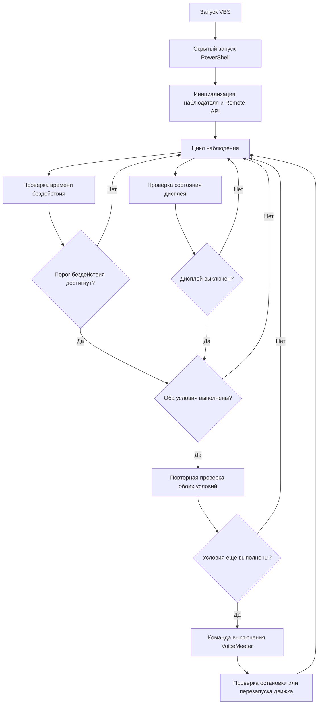

# VoiceMeeter IdleWatcher

[English](README.md) | [Русский](README.ru.md)

Инструмент автоматизации VoiceMeeter для Windows на PowerShell. Он отслеживает время бездействия Windows и состояние питания дисплея и отправляет команду на выключение VoiceMeeter только тогда, когда истёк заданный порог бездействия и дисплей полностью выключен.

**Памятка сопровождающего проекта:** см. [PROJECT_CONTEXT.md](PROJECT_CONTEXT.md). Это основной документ для восстановления контекста, истории проекта, подтверждённого поведения, известных ограничений и продолжения работы в новом чате ChatGPT.

## Возможности

- Отслеживание времени бездействия пользователя Windows.
- Контроль состояния дисплея через системные уведомления Windows о питании.
- Автоматическое отключение VoiceMeeter разрешается только при одновременном выполнении двух условий:
  - Достигнут порог бездействия.
  - Состояние дисплея — **Off** (0).
- Автоматическое отключение блокируется, если дисплей включён (**On**, 1), затемнён (**Dimmed**, 2) или его состояние неизвестно.
- Взаимодействие с VoiceMeeter через Remote API.
- Поиск подходящей DLL Remote API по сведениям об установке VoiceMeeter в реестре и стандартных каталогах Program Files.
- Защита от запуска нескольких экземпляров наблюдателя с помощью именованного mutex.
- Штатная остановка через именованное событие Windows.
- Основной, резервный и аварийный журналы работы.

## Принцип работы

Наблюдатель периодически проверяет длительность бездействия Windows и текущее состояние дисплея.

Порог бездействия по умолчанию составляет **8 минут**. Команда на отключение VoiceMeeter отправляется только при полностью выключенном дисплее и по достижении этого порога. Непосредственно перед отправкой команды скрипт повторно проверяет оба условия.

Если VoiceMeeter не запущен, наблюдатель продолжает мониторинг. Если VoiceMeeter перезапустится, пока компьютер остаётся бездействующим, а дисплей выключен, наблюдатель может обнаружить перезапуск и повторно отправить команду отключения.

Неизвестное состояние дисплея считается безопасным: автоматическое отключение блокируется.

## Архитектура

Схема ниже показывает основной поток работы. Подробное двуязычное описание, включая штатную остановку и освобождение ресурсов, находится в [ARCHITECTURE.md](ARCHITECTURE.md).

## Текущие параметры

| Параметр | По умолчанию | Назначение |
|---|---:|---|
| IdleMinutes | 8 | Порог бездействия в минутах. Допустимый диапазон: 1–60. |
| CheckIntervalSec | 10 секунд | Обычный интервал ожидания основного цикла. |
| RetryIntervalSec | 30 секунд | Интервал повторной попытки после ошибок API. |
| DebugMode | Выключен | Включает подробные записи DEBUG при передаче переключателя -DebugMode. |

Для восстановления API-сессии и проверки остановки или повторного запуска VoiceMeeter используются дополнительные внутренние интервалы.

## Файлы проекта

| Файл | Назначение |
|---|---|
| VoiceMeeter-IdleWatcher.ps1 | Основной PowerShell-скрипт наблюдения и взаимодействия с VoiceMeeter Remote API. |
| VoiceMeeter-IdleWatcher.vbs | Скрытый запускатель и точка входа для штатной остановки. |
| README.md | Документация на английском языке. |
| README.ru.md | Документация на русском языке. |
| PROJECT_CONTEXT.md | Памятка сопровождающего проекта и точка восстановления контекста. |
| ARCHITECTURE.md | Двуязычное описание архитектуры и схемы Mermaid. |
| CHANGELOG.md | История изменений репозитория и исходная точка разработки. |
| .gitignore | Исключает из Git локальные логи, временные файлы, резервные копии и базы KeePass. |
| .github/workflows/powershell-check.yml | Запускает автоматическую проверку синтаксиса и анализ PSScriptAnalyzer в Windows PowerShell 5.1. |

Файлы PS1 и VBS должны находиться в одной папке. VBS-запускатель ищет PS1 рядом с собой и ожидает совпадения базовых имён файлов.

## Требования

- Windows.
- Windows PowerShell 5.1.
- Установленный VoiceMeeter.
- DLL VoiceMeeter Remote API, соответствующая разрядности процесса PowerShell.
- Включённый Windows Script Host для запуска VBS.

Скрипт ищет сведения об установке VoiceMeeter в реестре Windows и стандартных каталогах Program Files. Используется соответствующая DLL: VoicemeeterRemote64.dll для 64-разрядного PowerShell или VoicemeeterRemote.dll для 32-разрядного процесса.

## Запуск и остановка

### Запуск

Дважды щёлкните VoiceMeeter-IdleWatcher.vbs либо выполните:

~~~text
wscript.exe VoiceMeeter-IdleWatcher.vbs
~~~

VBS-запускатель запускает Windows PowerShell в скрытом окне и ожидает явного статуса запуска. Ошибка на раннем этапе сообщается отдельно, а не считается успешным запуском.

### Остановка

Запустите VBS-файл с аргументом /stop:

~~~text
wscript.exe VoiceMeeter-IdleWatcher.vbs /stop
~~~

Запрос на остановку передаётся через именованное событие Windows. Затем наблюдатель выполняет Logout из VoiceMeeter Remote API, освобождает ресурсы уведомлений, mutex единственного экземпляра и завершает работу. Запускатель ожидает результат остановки.

Остановка наблюдателя **не выключает VoiceMeeter**. Она только прекращает работу автоматизации.

## Интеграция с VoiceMeeter MacroButtons

Для запуска и остановки наблюдателя можно использовать двухпозиционную кнопку MacroButtons. Команды ниже приведены в точной форме, работающей в текущей локальной конфигурации автора проекта.

**Действие ON (START):**

~~~vb
System.Execute("%windir%\\System32\\cmd.exe","C:\\Users\\serge\\Desktop\\VoiceMeeter Automation","/C wscript.exe VoiceMeeter-IdleWatcher.vbs");
~~~

**Действие OFF (STOP):**

~~~vb
System.Execute("%windir%\\System32\\cmd.exe","C:\\Users\\serge\\Desktop\\VoiceMeeter Automation","/C wscript.exe VoiceMeeter-IdleWatcher.vbs /stop");
~~~

Путь к рабочей папке относится к текущему компьютеру автора. На другом компьютере его необходимо заменить на каталог, в который установлены оба файла проекта. Перед переводом репозитория в публичный режим этот персональный путь нужно заменить примером или удалить.

Пока наблюдатель работает, он периодически устанавливает ON для настроенной кнопки через VoiceMeeter Remote API. Он не читает состояние кнопки: наблюдатель и так знает состояние собственного процесса. Режим API STATEONLY меняет только отображение и никогда не запускает макрос кнопки. При штатной остановке наблюдатель устанавливает OFF.

Параметр $MacroButtonLogicalIndex задаёт логический ID кнопки VoiceMeeter Remote API с нуля. Сейчас установлено значение 1; ID 0 зарезервирован под кнопку микрофона. Значение -1 отключает синхронизацию.

Повторный запрос START не создаёт второй процесс наблюдателя. Он посылает работающему экземпляру сигнал через auto-reset событие, чтобы немедленно обновить кнопку, не ожидая обычного десятисекундного интервала. Периодическая установка ON также восстанавливает отображение, если MacroButtons открыли уже после запуска наблюдателя.

Если настроенная кнопка или функция API недоступна, синхронизация пропускается и повторяется позже. Эти необязательные проблемы отражаются только в DEBUG, не останавливают наблюдатель и не создают поток повторяющихся ERROR-записей. Второй процесс для наблюдения за кнопкой не создаётся.

GitHub Actions проверяет синтаксис исходника, контракт STATEONLY и компиляцию встроенного C#. Фактическую работу MacroButtons ещё нужно проверить на Windows-компьютере автора: GitHub Actions не может проверить локальный интерфейс.

## Журналы

- Основной лог: VoiceMeeter-IdleWatcher.log в папке скрипта.
- Резервный лог: %LOCALAPPDATA%\VoiceMeeter-IdleWatcher\VoiceMeeter-IdleWatcher-fallback.log.
- Аварийный лог: %TEMP%\VoiceMeeter-IdleWatcher-emergency.log.

Основной и резервный логи архивируются при достижении заданного ограничения размера. Файлы логов и их архивы исключены из Git через .gitignore; добавлять их в репозиторий не следует.

## Примечание о разработке

Проект создавался при существенном и активном участии ChatGPT. Взаимодействие включало обсуждение архитектуры, анализ реализации, поиск причин ошибок, разбор изменений кода и подготовку документации. Автор проекта сохраняет контроль над исходными файлами и выполняет проверку работы на целевой системе.

## Лицензия

Лицензия пока не выбрана. До добавления лицензии не следует считать, что код разрешено свободно использовать, распространять или изменять.
